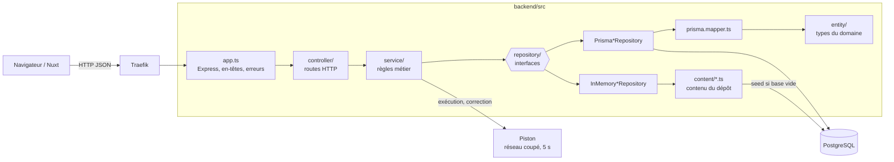

# Backend Scalar

API REST en Node.js (TypeScript exécuté nativement), Express 5, PostgreSQL via
Prisma, validation par zod. Elle sert le contenu pédagogique (parcours,
chapitres, cours, exercices) et délègue l'exécution du code soumis à
[Piston](https://github.com/engineer-man/piston), un moteur isolé.

## Architecture



| Dossier            | Rôle                                                                                                                                                               |
| ------------------ | ------------------------------------------------------------------------------------------------------------------------------------------------------------------ |
| `src/controller/`  | Une classe par ressource : lit la requête, appelle le service, répond avec l'enveloppe commune.                                                                    |
| `src/service/`     | Règles métier : numérotation, masquage des brouillons, conversion TypeScript → JavaScript (`stripTypeScriptTypes` de Node), appel à Piston, harnais de correction. |
| `src/repository/`  | Interfaces d'accès au contenu, avec deux implémentations : Prisma (PostgreSQL) et en mémoire (`CONTENT_SOURCE=mock`).                                              |
| `src/entity/`      | Types du domaine, indépendants de Prisma ; la conversion est dans `repository/prisma.mapper.ts`.                                                                   |
| `src/content/`     | Contenu rédigé dans le dépôt : source du seed et des dépôts en mémoire.                                                                                            |
| `src/database/`    | Client Prisma, migrations au démarrage, seed (`seed.cli.ts`).                                                                                                      |
| `src/http/`        | Enveloppe de réponse, erreurs (404, 4xx, 500 génériques), en-têtes de sécurité.                                                                                    |
| `src/config.ts`    | Variables d'environnement, validées par zod au démarrage.                                                                                                          |
| `src/constants.ts` | Limites (taille du code, durée d'exécution) et messages renvoyés au client.                                                                                        |
| `prisma/`          | Schéma et migrations SQL.                                                                                                                                          |

Toutes les réponses suivent la même enveloppe, définie dans `@scalar/shared`
(`packages/shared`) : `{ success, data, error }`. Une erreur ne renvoie jamais
de détail interne (pile, adresse du moteur, message SQL).

## Routes

Toutes sous `/api/v1`.

| Méthode | Route                                                                | Rôle                                                                        |
| ------- | -------------------------------------------------------------------- | --------------------------------------------------------------------------- |
| `GET`   | `/`                                                                  | Présence de l'API                                                           |
| `GET`   | `/health`                                                            | Source du contenu et état de la base                                        |
| `GET`   | `/tracks`                                                            | Parcours, avec langage et prérequis                                         |
| `GET`   | `/tracks/:track`                                                     | Un parcours et ses chapitres numérotés                                      |
| `GET`   | `/tracks/:track/chapters/:chapter/lessons/:lesson`                   | Un cours publié                                                             |
| `GET`   | `/tracks/:track/chapters/:chapter/exercises/:exercise`               | Un exercice publié, sans sa solution                                        |
| `POST`  | `/tracks/:track/chapters/:chapter/exercises/:exercise/verifications` | Correction : un verdict par cas de test, sans révéler les valeurs attendues |
| `POST`  | `/executions`                                                        | Exécution libre d'un code JavaScript ou TypeScript                          |

## Configuration

Lue dans l'environnement (ou `backend/.env`, voir `backend/.env.example`) par
`src/config.ts`. Une valeur invalide arrête le démarrage en nommant la variable.

| Variable              | Défaut                      | Rôle                                                                       |
| --------------------- | --------------------------- | -------------------------------------------------------------------------- |
| `NODE_ENV`            | `development`               | `production` : le serveur écoute lui-même sur `PORT` (sinon Vite le sert). |
| `PORT`                | `3001`                      | Port d'écoute.                                                             |
| `LOG_LEVEL`           | `info`                      | Niveau du journal pino.                                                    |
| `CONTENT_SOURCE`      | `database`                  | `database` ou `mock` (contenu du dépôt, sans PostgreSQL).                  |
| `DATABASE_URL`        | —                           | Obligatoire si `CONTENT_SOURCE=database`.                                  |
| `SEED_ON_EMPTY`       | `true`                      | Charge le contenu du dépôt si la base n'a aucun parcours.                  |
| `PISTON_URL`          | `http://piston:2000/api/v2` | Adresse du moteur, joignable seulement depuis le réseau du compose.        |
| `PISTON_NODE_VERSION` | `20.11.1`                   | Version de Node installée dans Piston, à l'identique.                      |

`DATABASE_URL_TEST` n'est lue que par les tests.

## Lancer

Pile complète (frontend, admin, backend, PostgreSQL, Traefik, Piston), depuis la
racine :

```bash
docker compose up -d
```

L'API répond alors sur http://localhost:8080/api/v1 (via Traefik). Au
démarrage, le backend applique les migrations et charge le contenu si la base
est vide.

Scripts du backend (depuis la racine, avec `--workspace backend`) :

| Commande                                     | Rôle                                                                                     |
| -------------------------------------------- | ---------------------------------------------------------------------------------------- |
| `npm run dev --workspace backend`            | Serveur de développement (Vite, rechargement à chaud)                                    |
| `npm run start --workspace backend`          | Serveur Node, sans outil de build                                                        |
| `npm run db:migrate --workspace backend`     | Applique les migrations (`prisma migrate deploy`)                                        |
| `npm run db:migrate:dev --workspace backend` | Crée une migration en développement                                                      |
| `npm run db:seed --workspace backend`        | Remplace le contenu de la base par celui du dépôt, après vérification de chaque exercice |

## Tests

Vitest, dans `tests/backend/` (même arborescence que `backend/src/`) :

```bash
npm run test --workspace backend            # toute la suite
npm run test:watch --workspace backend      # relance à chaque modification
npm run test:coverage --workspace backend   # couverture
```

- **Sur une vraie base** : une partie des tests tourne sur `scalar_test`, une
  base dédiée du PostgreSQL du compose (`docker compose up -d postgres`), jamais
  sur la base de développement. Elle est créée et migrée au premier lancement ;
  `DATABASE_URL_TEST` permet d'en choisir une autre.
- **Parité base / mémoire** : les dépôts Prisma et les dépôts en mémoire doivent
  donner exactement les mêmes réponses (`tests/backend/repository/`).
- **Contenu du dépôt** : chaque exercice est vérifié (la solution passe ses cas,
  le code de départ non), ainsi que l'unicité, l'ordre et les références.
- **API** : chaque route est appelée sur un vrai serveur HTTP ; Piston y est
  remplacé par une exécution locale du harnais.

Aujourd'hui : 142 tests, environ 98 % des lignes couvertes. L'exécution réelle
par Piston se vérifie à la main, pile démarrée (voir le README racine).

## Qualité et CI

| Outil                      | Commande                                | Configuration      |
| -------------------------- | --------------------------------------- | ------------------ |
| ESLint (typescript-eslint) | `npm run lint --workspace backend`      | `eslint.config.js` |
| TypeScript                 | `npm run typecheck --workspace backend` | `tsconfig.json`    |
| Prettier                   | `npm run format --workspace backend`    | `.prettierrc.json` |

`.github/workflows/ci.yml` lance lint, typecheck et tests (avec un PostgreSQL
de service) sur chaque push vers `main` et chaque pull request, puis construit
l'image Docker de production de chaque espace (`backend/Dockerfile`, cible
`prod`).

## En cours

- Limitation de débit des exécutions et des vérifications.
- En-têtes de sécurité (CSP, Referrer-Policy, HSTS).
- Tables apprenant : comptes, authentification, progression.
- Questionnaire de positionnement.
